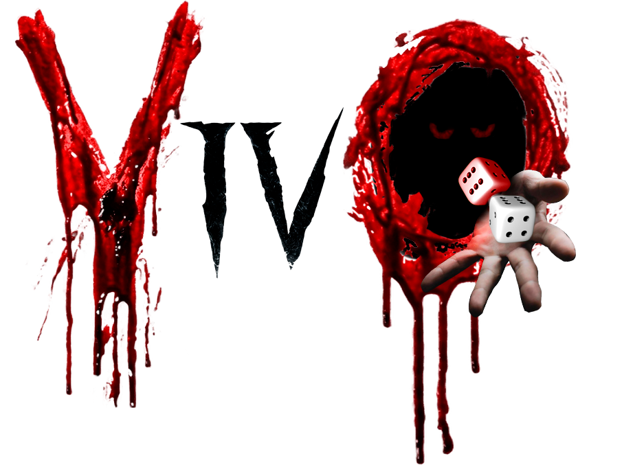
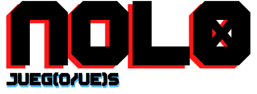
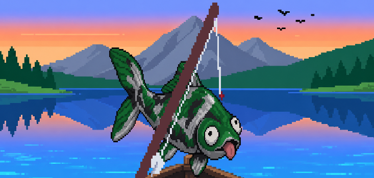
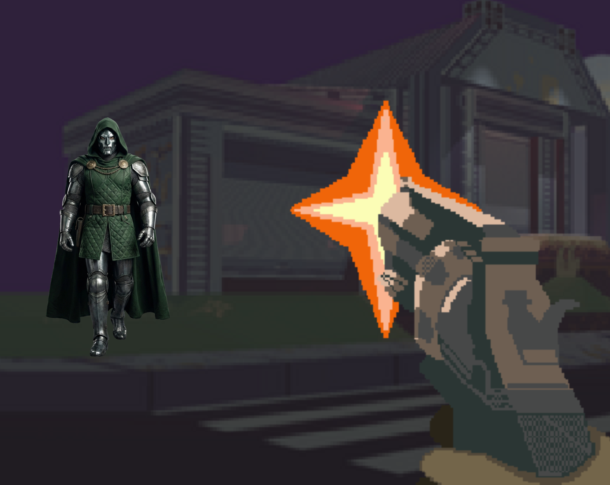
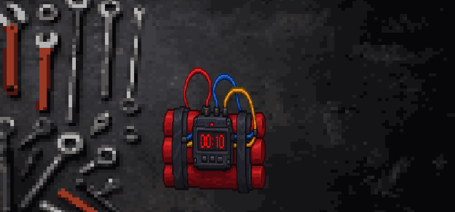
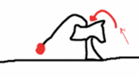
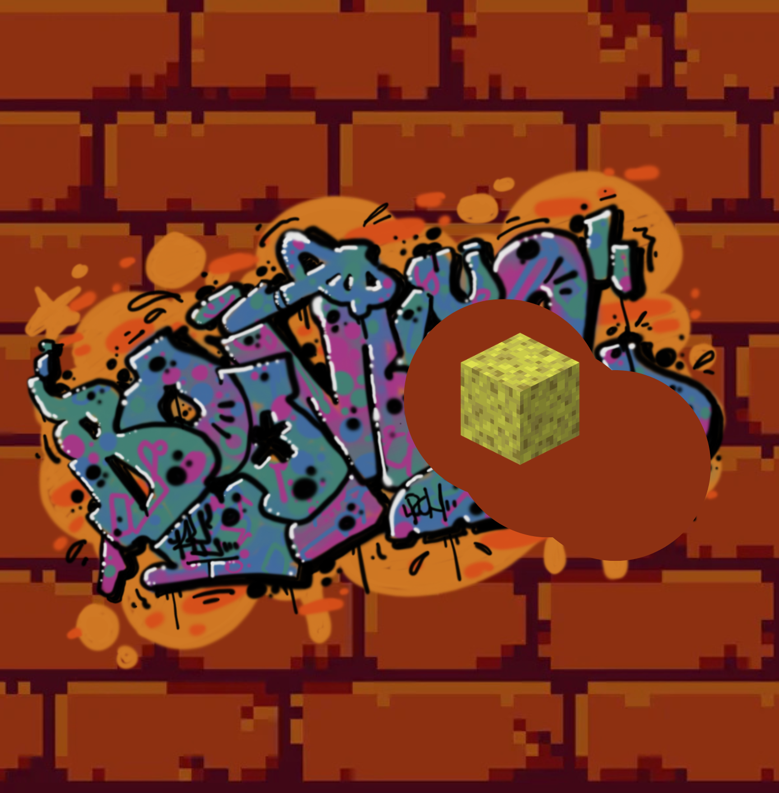
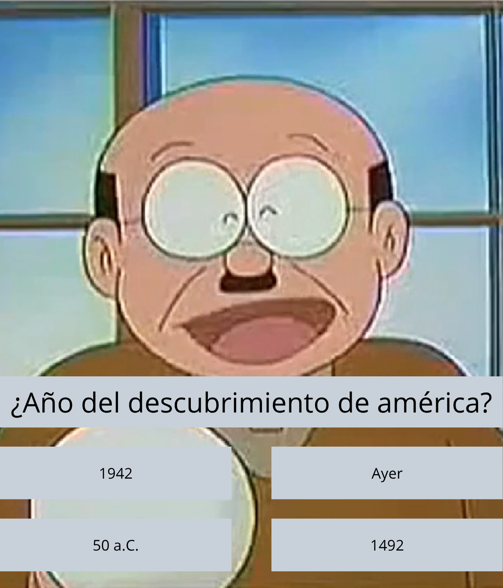
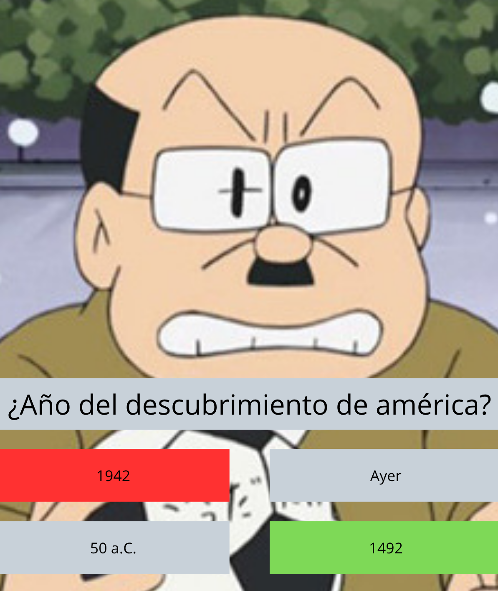

<h1 align="center">VivO</h1>

  

<h2 align="center">Juego realizado por:</h2>

  

<h2 align="center">Integrantes:</h2>

- Víctor Román Román
- Daniel García Andrés
- Marcos Solano Pascual
- Marcos Tedín Cueto

<h2 align="center">Descripción del juego:</h2>

En VivO controlas a un personaje que debe recorrer un tablero maldito dividido en múltiples casillas con diversos minijuegos donde cada paso te costará años de vida. Podrás apostar años de vida en juegos de azar y comprar distintos dados pero evita no sacar por tu bien el número 4.

<h2 align="center">1. Concepto general</h2>

- **Género:** Party Game / Minijuegos
- **Estructura:** Juego de tablero + minijuegos + apuestas
- **Jugadores:** 2
- **Plataforma:** PC
- **Integrantes del grupo:** Daniel García Andrés, Víctor Román Román, Marcos Solano Pascual y Marcos Tedín Cueto.

En vivo controlas a un personaje que debe recorrer un tablero maldito dividido en múltiples casillas con diversos minijuegos donde cada paso te costará años de vida. Podrás apostar años de vida en juegos de azar y comprar distintos dados pero evita no sacar por tu bien el número 4.

Se comienza la partida con una determinada cantidad de años de vida, por ejemplo, 100. A medida que avanza por el tablero, va perdiendo años de vida, y mediante los minijuegos y las apuestas se pueden ganar años de vida en caso de éxito, o perderlos en el caso contrario.

Además de llegar al final del tablero, el objetivo final de la partida es llegar con al menos 1 año de vida.

<h2 align="center">2. Historia / Lore</h2>

Kentaro Mia-Ura, un espía japonés, desapareció repentinamente en una misión. Tras declararlo muerto, entre su herencia, su esposa recibió un cuaderno que no tuvo fuerzas de abrir.

Cuando sus hijos Staki Mia-Ura y Akita Mia-Ura le preguntan sobre su difunto padre, la mujer de Kentaro les revela la existencia de dicho cuaderno en el desván de su casa. Intrigados, al abrirlo descubren una especie de tablero dibujado sobre el papel, que enseguida atrapa el alma de los hermanos en un macabro juego que va drenando poco a poco sus vidas.

Los hermanos comienzan a jugar con la teoría de que sólo se librarán de su influencia una vez completado, pero no se les hará fácil, cada movimiento les drena una parte de su ser. Jugada tras jugada visitan recuerdos y situaciones pertenecientes a otra persona, alguien que descubrirán que se trata de su padre. Lo que los hermanos no saben es que al final solo uno podrá escapar del juego…

Pero había algo mal. Parecía como si hubiera algo que intentara corromper cada recuerdo, lo mismo que lo estaba obligando a jugar por su vida. Ese algo fue el causante de la muerte de Kentaro. En su última misión, murió junto a su objetivo, y ambos acabaron imbuyendo el viejo diario de Kentaro Mia-Ura con sus almas.

<h3 align="center">Relación con el tema de aura</h3>

El aura y el alma son conceptos bastante parecidos pero no iguales, el alma es la esencia espiritual de una persona mientras que el aura es el campo exterior que proyecta el alma. La maldición del tablero se lleva los años de vida del jugador a través de alimentarse de su aura dejando así indefensa su alma.

<h2 align="center">3. Objetivo del jugador</h2>

El objetivo principal del juego es llegar a la casilla final del tablero con 1 o más años de vida.

Los años de vida funcionan como el principal recurso del juego.

- Si el jugador pierde todos sus años de vida pierde.
- Si llega a la casilla final con años de vida consigue romper la maldición y ganar la partida.
- Los minijuegos pueden hacer que el jugador gane o pierda años de vida.
- Las apuestas permiten arriesgar años para intentar conseguir más.

<h2 align="center">4. Sistema de años de vida</h2>

El jugador comienza con una cantidad determinada de años de vida.

Por ejemplo:

**100 años de vida**

Los años pueden modificarse durante la partida mediante:

- **Movimientos por el tablero:** la cantidad de casillas avanzadas equivale a los años de vida perdidos.
- **Resultado de los minijuegos:** al ganar un minijuego ganas años de vida mientras que al perderlo los pierdes.
- **Apuestas** (explicado más adelante).

Los años de vida sirven, por tanto, como:

- Vida del jugador.
- Recurso para apostar.
- Condición de victoria.

<h2 align="center">5. Tablero</h2>

El juego se desarrolla sobre un tablero por el que los jugadores avanzan mediante dados.

El jugador tira el dado y avanza tantas casillas como indique el resultado.

Dependiendo de la casilla en la que termine, puede ocurrir diferentes cosas, principalmente:

- Activar un minijuego.
- Entrar en una casilla en blanco en la que no ocurre nada.
- Cae en una casilla especial.
- Avanzar hacia la casilla final.

Cada movimiento supone además un coste de años de vida igual a la cantidad avanzada, por lo que avanzar demasiado también supone un riesgo.

En algunas partes del tablero existen bifurcaciones donde el jugador podrá escoger el camino.

<h3 align="center">Casillas especiales</h3>

- Casilla de años de vida.
- Casilla que resta años de vida.
- Casilla que intercambia con el otro jugador?
- Casilla wither skeleton.

<h2 align="center">6. Sistema de dados</h2>

Existen diferentes tipos de dados:

- **Dado normal:** es el dado utilizado inicialmente por el jugador. Una característica importante es que no contiene el número 4. El número 4 está relacionado con la maldición y con el modo Infierno.
- **Arriesgado:** es un dado con resultados mejores, pero que introduce el riesgo de obtener un 4. Puede proporcionar resultados especialmente beneficiosos, como conseguir más años de vida o avanzar más, pero existe la posibilidad de activar el modo Infierno al sacar el número 4.

La idea principal del sistema es: **Más recompensa = mayor riesgo.** (Cumpliendo así nuestra carta de “Pócimas y brebajes”).

<h2 align="center">7. El número 4</h2>

El número 4 es uno de los elementos centrales de la temática del juego.

Está relacionado con la mala suerte y la maldición en la cultura asiática, temática predominante en nuestro juego para cumplir así con nuestra carta de “Japón”. Ya que en japonés el 4, en una de sus pronunciaciones (L, shi) se pronuncia igual que la palabra muerte (shi, 死).

Obtener un 4 activa el modo Infierno haciendo que la dificultad de todos los minijuegos incremente y la ambientación del tablero cambie.

<h2 align="center">8. Modo Infierno</h2>

Cuando el jugador obtiene un 4, el tablero entra en el modo Infierno.

El tablero cambia visualmente y adopta una apariencia más oscura.

La representación del jugador en el tablero se convierte en Kratos para cumplir así con nuestra carta “Kratos”. Esto referenciando al primer God of War donde Kratos tiene que salir del inframundo.

Además, todos los minijuegos aumentan su dificultad.

Ejemplos:

| Minijuego | Dificultad normal | Modo Infierno |
|---|---|---|
| Pesca | Zona de pesca normal | Zona más pequeña |
| Shooter | Velocidad normal | Enemigos más rápidos / más enemigos |
| Vasos | Velocidad normal | Vasos más rápidos |
| Limpieza | Tiempo normal | Menos tiempo |
| Profesor | Preguntas normales | Más opciones / dificultad |
| Kendama | Física normal | Mayor dificultad de control |
| Bomba | Pista normal | Pista más complicada / menos tiempo |

<h2 align="center">9. Minijuegos</h2>

Los minijuegos son uno de los elementos principales del gameplay, que estarán repartidos a lo largo de las casillas del tablero.

Hay dos tipos de minijuego: la laguna mental y los bosses.

El jugador enfrentará diferentes minijuegos dependiendo de la casilla en la que caiga, y en función de tener éxito o no, ganará o perderá años de vida.

La laguna mental será una casilla con un diseño de nubarrón negro (WIP) en la que saldrán minijuegos aleatorios.

El boss será una casilla con un minijuego bien marcado y de dificultad aumentada. Visualmente también se verá cambio.

<h3 align="center">9.1. Pesca de Koi</h3>

Minijuego basado en la pesca.

El minijuego muestra una de las memorias de Kentaro en las que pasa su tiempo libre haciendo lo que más le gustaba, pescar.

La escena se conforma de una vista en primera persona con la caña de pescar a la derecha de la pantalla y la vista de la barca en la parte inferior de la pantalla. Justo en la parte central aparecerá el pez (o los peces, WIP) que el jugador debe pescar.

A la hora de pescar, delante del pez aparecerá una barra por la que se moverá un indicador de lado a lado. Aleatoriamente, en la barra aparecerá una zona de distinto color que será la zona de pesca, donde se pulsará el input (acción de recoger el sedal) cuando el indicador esté encima.

De todos los minijuegos, es uno de los de dificultad más baja.

En el modo Infierno la zona de pesca se ve reducida notablemente.

**Boceto:**

  

<h3 align="center">9.2. Shooter</h3>

En este minijuego se muestra una de las memorias de Kentaro como espía. En ella se muestra una de sus misiones más frenéticas y peligrosas, en la que numerosos enemigos se abalanzaron sobre él y consiguió tumbarlos a todos únicamente con una pistola. Tras esta misión fue cuando comenzó su ascenso dentro de las fuerzas japonesas.

El jugador tendrá una pistola y deberá disparar con ella a diferentes enemigos que se acercan progresivamente.

Los enemigos aparecen en grandes cantidades y el jugador debe eliminarlos antes de que lleguen demasiado cerca.

El jugador dispone inicialmente de 8 balas, que se podrán recargar.

Existe además una mecánica relacionada con el número 4:

Si el cargador llega a 4 balas, el jugador pierde, independientemente de que le queden balas o no haya sido alcanzado por ningún enemigo.

Esto obliga al jugador a controlar constantemente la munición además de eliminar a los enemigos.

En el modo Infierno aparecen más enemigos y se acercan más deprisa.

**Boceto:**

  

<h3 align="center">9.3. Bomba</h3>

El jugador encuentra una bomba con diferentes cables.

Antes de cortar debe recibir una pista que indica qué cable debe cortar.

El objetivo es interpretar correctamente la pista y cortar el cable correcto antes de que termine el tiempo.

En el modo Infierno, el tiempo se reduce / la pista es más complicada.

**Boceto:**

  

<h3 align="center">9.4. Kendama</h3>

Minijuego basado en un kendama.

El jugador debe utilizar las físicas para conseguir que la bola termine correctamente colocada en el palo.

La dificultad depende principalmente del control y de las físicas del objeto.

En el modo Infierno, las físicas / control pueden hacerse más difíciles.

**Boceto:**

  

<h3 align="center">9.5. Limpieza</h3>

Minijuego inspirado en juegos como PowerWash Simulator.

El jugador encuentra una superficie / mancha que debe limpiar utilizando el ratón.

Existe un tiempo limitado para conseguir limpiarla.

**Objetivo:**

Limpiar la mancha antes de que se acabe el tiempo.

En el modo Infierno se reduce el tiempo disponible.

**Boceto:**

  

<h3 align="center">9.6. El profesor enfadado</h3>

El jugador se encuentra con un personaje que le realiza una pregunta.

Entre varias opciones, se debe seleccionar la respuesta correcta.

Si responde incorrectamente, el personaje le lanza un objeto con un carácter japonés a la cabeza y recibe daño / pierde el minijuego.

En el modo Infierno aumenta la dificultad de las preguntas o el número de respuestas posibles.

**Bocetos:**

  

  

<h2 align="center">10. Zona de apuestas</h2>

<h3 align="center">10.1. Ruleta</h3>

Juego de apuestas basado en una ruleta. El jugador apuesta años de vida y puede obtener una recompensa mayor dependiendo del resultado.

El jugador podrá escoger entre rojo y negro (x2) o verde (x35) imitando el funcionamiento de una ruleta real.

<h3 align="center">10.2. Ruleta rusa</h3>

Juego de apuestas basado en la ruleta rusa.

El jugador apuesta años de vida a cambio de la posibilidad de conseguir una recompensa mayor dependiendo de cuántas balas haya en la pistola.

<h2 align="center">11. Dirección artística</h2>

El juego combina una temática japonesa (siguiendo la carta de ambientación “Japón”) y el arte del juego tiene un estilo de boceto como si estuviera dibujado a mano (siguiendo la carta de ambientación “En blanco”).

Además el modo Infierno provoca un cambio de skin en el tablero volviéndose más oscuro y acorde a este modo.

<h2 align="center">12. Core Gameplay Loop</h2>

El ciclo principal del juego sería:

1. Escoger dado.
2. Tirar dado.
3. Avanzar por el tablero perdiendo años de vida en el proceso.
4. Caer en una casilla.
5. Jugar un minijuego si caes en una casilla de minijuego.
6. Ganar o perder años de vida dependiendo de si ganas o no.
7. Decidir si realizar una apuesta o no, sufriendo las consecuencias al momento de decidirse el resultado.
8. Siguiente turno.

<h2 align="center">13. Condiciones de Victoria y Derrota</h2>

<h3 align="center">Victoria</h3>

Si el jugador llega al final del tablero y todavía conserva años de vida supera el juego y se libera de la maldición del tablero.

<h3 align="center">Derrota</h3>

Si el jugador llega a 0 años de vida antes de llegar al final del tablero, la maldición acaba con él y muere.

<h2 align="center">14. Identidad del juego</h2>

Un juego de tablero en el que algunas casillas contienen diversos minijuegos donde el jugador constantemente tiene que decidir entre jugar de forma segura o arriesgar sus años de vida para conseguir ventajas tratando de evitar el número 4, que podría cambiar totalmente la partida.
