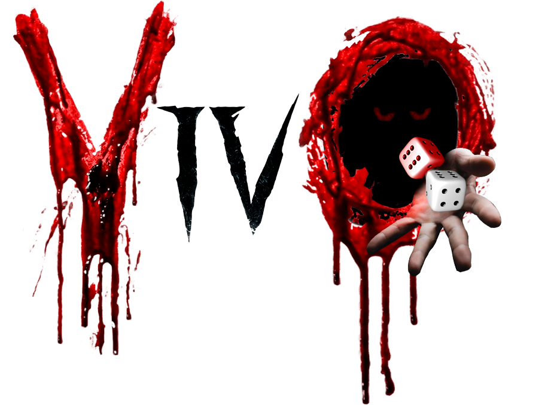

<h1 align = "center">VivO<h1/>

  

<h2 align = "center">Juego realizado por:<h2/>

  

<h2 align = "center">Integrantes:<h2/>

- Víctor Román Román

- Daniel García Andrés

- Marcos Solano Pascual

- Marcos Tedín Cueto

<h2 align = "center">Descripción del juego:<h2/>

En VivO controlas a un personaje que debe recorrer
un tablero maldito dividido en múltiples casillas con
diversos minijuegos donde cada paso te costará años
de vida. Podrás apostar años de vida en juegos de azar
y comprar distintos dados pero evita no sacar por tu
bien el número 4.
