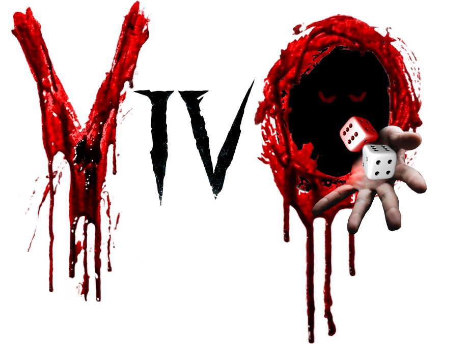
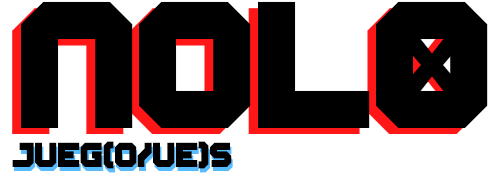
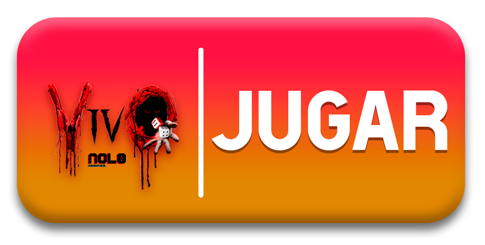

<h1 align = "center">VivO</h1>

  

Proyecto universitario para la asignatura de Programación de videojuegos en lenguajes interpretados.

<h2 align = "center">Juego realizado por:</h2>

  

<h2 align = "center">Integrantes:</h2>

- Víctor Román Román

- Daniel García Andrés

- Marcos Solano Pascual

- Marcos Tedín Cueto

<h2 align="center">Descripción del juego:</h2>

**VivO** es un party game de tablero para dos jugadores en PC que combina minijuegos, gestión de recursos y apuestas. Los jugadores encarnan a Staki Mia-Ura y Akita Mia-Ura, dos hermanos atrapados en un diario maldito heredado de su padre, un espía japonés desaparecido. Para romper la maldición deberán recorrer un tablero dividido en casillas y llegar a la meta conservando al menos un año de vida; cada casilla avanzada consume años de vida, que funcionan a la vez como salud, recurso para apostar y condición de victoria.

Durante la partida, los jugadores deberán decidir constantemente entre avanzar con dados seguros o arriesgarse con dados que ofrecen mejores recompensas pero incluyen el número 4. Sacar un 4 activa el **Modo Infierno**: el tablero se vuelve más oscuro y todos los minijuegos aumentan su dificultad. Los minijuegos (la pesca de koi, el shooter, la bomba, el kendama, la limpieza o las preguntas del profesor) y las zonas de apuestas (ruleta y ruleta rusa) permiten recuperar o perder años de vida, obligando al jugador a equilibrar riesgo y supervivencia. Todo ello con una ambientación japonesa y un estilo artístico de boceto dibujado a mano.

<h2 align="center">Capturas del juego:</h2>

WIP.

<h2 align="center">Redes sociales:</h2>

  
  
  

<h2 align="center">Enlace a la web:</h2>

  <a href="https://vroman02.github.io/Grupo08-PVLI/" target="_blank">
    

